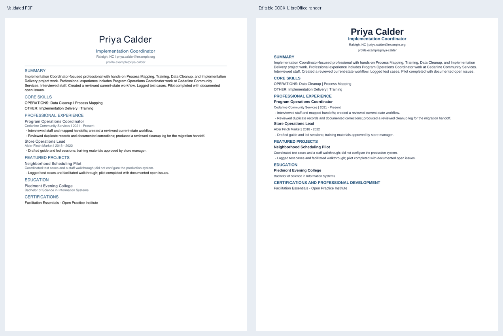
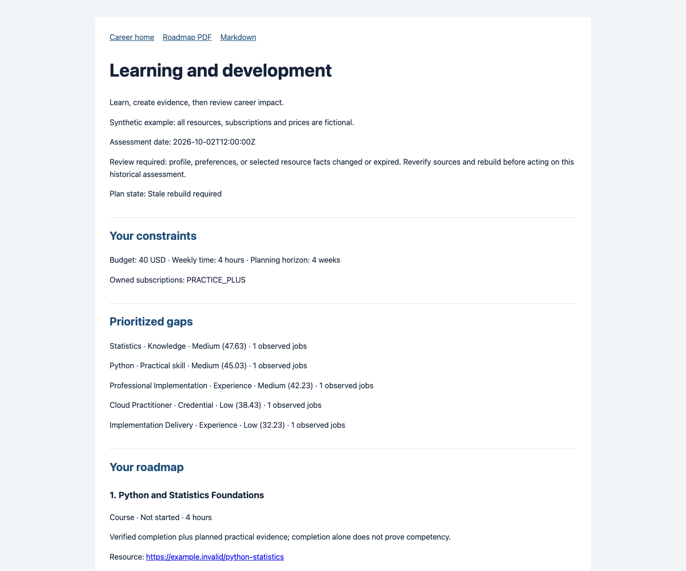

<p align="left"></p>

# Your career, connected.

**Career OS is an AI-powered career management and job search operating system.** Turn your experience, skills and professional evidence into clearer career pathways, better-qualified opportunities, stronger applications and a practical development plan.

Operate it through your AI assistant or the local CLI. Your approved career facts form one foundation for career planning, Resume Studio, job evaluation, applications, interviews and Learning Path Intelligence. Corrections mark dependent artifacts stale; application records preserve the exact materials you used.

[](https://github.com/dhwrd87/career-os/actions/workflows/ci.yml)
[](https://github.com/dhwrd87/career-os/releases/tag/v0.4.1)
[](LICENSE)

**Local workspace · Evidence-based recommendations · Human-reviewed career truth · MIT open source**

## See the system

All people, employers, opportunities and resource offers shown below are fictional. These are actual generated artifacts and saved screenshots.

### A home for your career


Navigate your profile, opportunities, application pipeline, interviews, reports and development roadmap from one workspace.

### Resumes built from the same evidence



Master, reusable lane-base and tailored resumes share your approved evidence. PDF validation checks selectable text, reading order, layout and artifact integrity; DOCX provides an editable export.

### Learning Path Intelligence



Connect market requirements to knowledge, skill, credential, experience and evidence gaps. Compare resources, respect budget/time/subscriptions, create practical evidence, track completion and reassess eligibility after reviewed profile updates. The dated synthetic example deliberately warns when its fictional source facts expire. **Course completion never becomes professional experience.**

Explore the [visual gallery](docs/visual-gallery.md), [synthetic workspace](examples/workspace/README.md) and [Learning Path Intelligence guide](docs/learning-path-intelligence.md).

## Install and start

Use **Python 3.11 or 3.12**. Install Poppler for PDF validation (`brew install poppler` on macOS, or `sudo apt-get install poppler-utils` on Ubuntu). Word or LibreOffice is optional for reviewing DOCX pagination.

```bash
python3.12 -m venv .venv
source .venv/bin/activate
python -m pip install "career-os[resume,docx] @ https://github.com/dhwrd87/career-os/releases/download/v0.4.1/career_os-0.4.1-py3-none-any.whl"
careeros version --json
careeros --workspace "$HOME/career-workspace" init
careeros --workspace "$HOME/career-workspace" doctor --json
careeros --workspace "$HOME/career-workspace" workspace dashboard
```

Open `$HOME/career-workspace/outputs/index.html`. Keep this workspace outside the source checkout. Career OS is distributed through [GitHub Releases](https://github.com/dhwrd87/career-os/releases); no PyPI installation is assumed.

To install from source instead, download the tag's **Source code** archive or clone this repository, then run `python -m pip install ".[resume,docx]"` from the checkout. See [installation](docs/installation.md), [quick start](skills/career-os/references/quickstart.md) and [troubleshooting](docs/troubleshooting.md).

## Use your AI assistant

For Codex, copy the complete `skills/career-os` directory from the source checkout into `~/.codex/skills/career-os`, then refresh skill discovery. Ensure the assistant shell can find `careeros`. The [skill archive](https://github.com/dhwrd87/career-os/releases/download/v0.4.1/career-os-0.4.1-skill.zip) contains the same installable skill.

Try:

- “Set up Career OS from my resume.”
- “Review and correct what you extracted before saving it.”
- “Find suitable career paths and build a base resume for this lane.”
- “Evaluate this opportunity and tailor my resume.”
- “Prepare a cover letter and application packet.”
- “Track this application and draft my follow-up.”
- “Prepare me for the technical interview.”
- “Show my career progress and highest-value development gaps.”
- “Build a learning roadmap within my budget and subscriptions.”
- “Find current courses and resources for these gaps.”
- “I finished this project; review the evidence and reassess my eligibility.”

The skill invokes real package commands, asks for missing facts and presents reviewable outputs. You approve canonical career information before it is committed. The CLI also works independently of an AI host. Codex-style orchestration and the executable router are tested; other AI-host integrations are unverified.

## Complete feature overview

| Module | What it connects |
|---|---|
| Career profile and evidence | Resume import, professional history, skills, credentials, education, accomplishments, projects, provenance and factual review |
| Career intelligence | Capability-based pathways, progression planning, career capital and observed-market signals |
| Job discovery | Bounded public-board retrieval, reviewed catalogs, persistent deduplication and source freshness |
| Opportunity qualification | Employer needs, requirement semantics, evidence mapping, career-family inheritance and prioritization |
| Resume Studio | Master and lane-base resumes, job tailoring, PDF/ATS/layout checks and editable DOCX |
| Application materials | Evidence-linked cover letters, application packets, artifact hashes and immutable submitted lineage |
| Pipeline and follow-up | Human-reported application states, outcomes, reminders/plans and local follow-up drafts |
| Interview preparation | Story banks, question themes, answer boundaries and technical walkthroughs |
| Learning Path Intelligence | Typed gaps, provider-neutral resource comparison, constrained roadmaps, projects, completion tracking, reviewed evidence/award updates and eligibility reassessment |
| Reporting and reliability | Conversion analytics, sample-size safeguards, dashboards, backup-first migrations, canonical transactions and recovery |

See the [full feature inventory](docs/features.md), [architecture](docs/architecture.md), [configuration](docs/configuration.md), [functional reconciliation](docs/functional-parity.md) and [learning parity](docs/learning-parity.md).

## Environments and known limitations

- **Local validation:** macOS with Python 3.12. **Automated matrix:** Ubuntu with Python 3.11 and 3.12; check the [actual CI results](https://github.com/dhwrd87/career-os/actions/workflows/ci.yml). Windows and Microsoft Word behavior are unverified.
- Discovery supports a bounded Greenhouse reader, reviewed catalogs and public learning-resource pages/indexes. Authenticated Coursera/LinkedIn Learning/Udemy search, scheduled alerts, enrollment and purchases are not implemented. Source facts require periodic verification.
- Learning ROI is descriptive; roadmap selection uses greedy resource reuse. It does not predict a salary or hiring outcome. Project hours are estimates and extra materials may need pricing.
- One premium single-column PDF template is supported. Identity and career data are configurable; arbitrary fonts/themes and broad non-Latin-script typography are not supported. DOCX pagination can differ. PDFs are selectable but untagged and not PDF/UA certified; ATS-vendor behavior is not universally verified.
- Career OS prepares and records activity. It does not submit applications, send messages, edit public profiles, schedule interviews or make commitments.

The [release evidence and full limitations](docs/release-readiness.md) distinguish verified behavior from unverified environments. Existing visual goldens are preserved.

## Your data, your workspace

The package writes career data to your selected local workspace. Keep it outside this repository and outside the skill directory. You control which sources and files your assistant may access; your AI host's data-processing terms still apply. External read-only discovery requires consent, and career facts remain reviewable with provenance.

Only synthetic examples belong in this public repository. Never upload a real resume, contact details, confidential employer evidence, credentials or private application records to an issue or discussion. See [privacy and approvals](docs/privacy-and-approvals.md) and [security](SECURITY.md).

## Contribute, report issues, discuss

Read [CONTRIBUTING.md](CONTRIBUTING.md). Report bugs in [Issues](https://github.com/dhwrd87/career-os/issues) with a minimal synthetic reproduction, Python/package versions, the command used and the observed result. Use [Discussions](https://github.com/dhwrd87/career-os/discussions) for questions and ideas. Follow [SECURITY.md](SECURITY.md) for sensitive reports.

```bash
python -m pip install ".[resume,docx,dev,test]"
python -m unittest discover -s tests -v
```

Career OS is released under the [MIT license](LICENSE). See the [changelog](CHANGELOG.md) and [v0.4.1 release notes](docs/release-notes-0.4.1.md).
