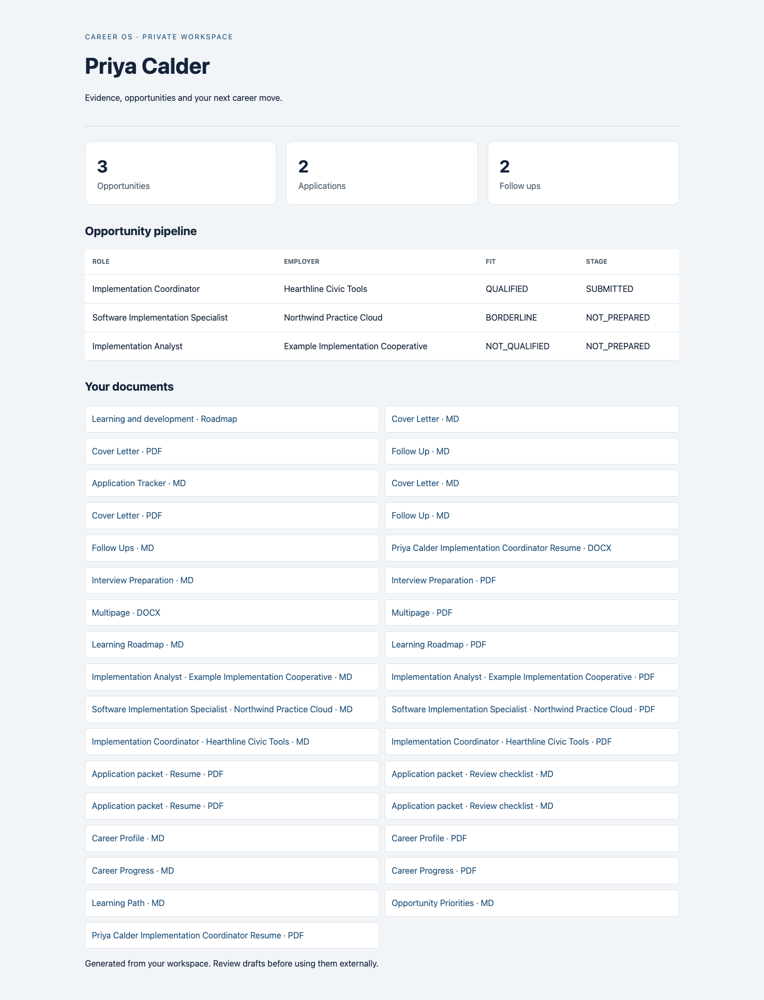
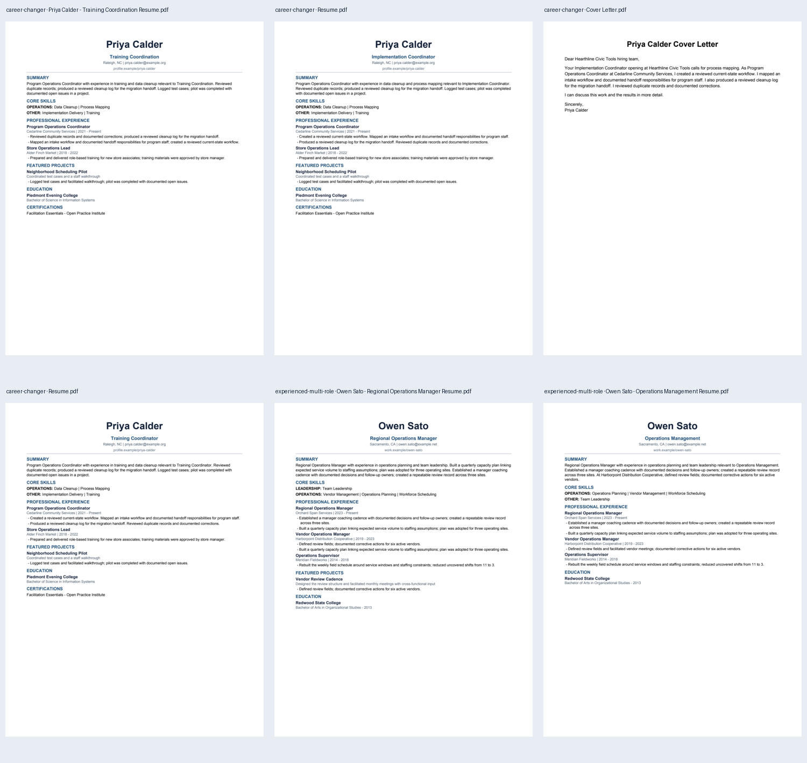

<p></p>

# Your career, from first resume to next role

Career OS brings your professional history, job search and career development into one private workspace. Work with your AI assistant to build a strong master resume, explore suitable career paths, find current openings and prepare complete application documents. Keep track of what happens, then use what you learn to plan your next step.

**[v0.4.3 — Complete Application Journey](https://github.com/dhwrd87/career-os/releases/tag/v0.4.3)** connects the full journey. It builds on the recruiter-focused writing, job discovery and learning tools in earlier releases.

[](https://github.com/dhwrd87/career-os/actions)
[](https://github.com/dhwrd87/career-os/releases/tag/v0.4.3)
[](LICENSE)

## Start with your experience. Finish with a practical next step.

| Ask in your own words | What happens |
|---|---|
| “Build my master resume.” | Import your resume or establish your history from scratch. Review missing details and accomplishments, approve the facts, then generate your master recruiter resume. |
| “What jobs and career paths fit my experience?” | Explore directions and job titles grounded in your history, goals and checked employer requirements. Build a practical search plan. |
| “Create resumes for the types of work I qualify for.” | Choose your career directions and prepare distinct starting resumes. Your complete history stays in your career record. |
| “Find current job openings that fit me.” | Search supported employer boards or compare reviewed postings. Check the full descriptions, qualifications and your preferences before ranking opportunities. |
| “Tailor resumes for my strongest matches.” | Automatically prepare separate, checked drafts for suitable, current jobs. Adapt supported summaries, accomplishments, skills, projects and qualifications without changing the facts. |
| “Prepare complete application packages for my five strongest matches.” | Build a folder for each suitable job, with PDF/DOCX resumes, application-link information, screening drafts and cover letters where needed. Keep missing answers visible. |
| “Help me track applications and prepare for interviews.” | Record activity you report, retain the documents used, prepare interview examples and review outcomes. |
| “What should I learn to qualify for better jobs?” | Identify gaps for stretch and dream roles. Compare current training options and plan courses, certifications, projects or experience-building steps around your starting point, time and budget. |

You do not need to learn the package's commands or internal terms. The assistant uses the executable tools, checks the results and gives you the documents to review.

Your opportunities use three groups:

- **Ready Now:** your recorded background fits the requirements checked, the posting is current and it fits your search.
- **Stretch Roles:** some skills, qualifications or details need work or review.
- **Dream Roles:** roles you have chosen as longer-term goals, with practical steps still to take.

These are planning groups, not predictions of a job offer. Missing information becomes a question to check, not an invented skill or qualification. A better-paying-role search needs a pay baseline and actual posting pay information; a title alone does not establish a pay rise.

## See the actual documents



Your career home links your profile, job matches, resumes, applications, interview preparation and development plans. The examples use fictional people, employers and postings.



Resumes use natural, professional writing, clear summaries and specific accomplishments. Each starts with facts and work examples you have approved. Existing factual, recruiter-copy, ATS extraction and layout checks remain in place. Actual employment titles, dates, qualifications and supported results stay intact.

Open the [complete fictional application example](examples/application-journey/README.md), [master resume](examples/application-journey/Master%20Resume.pdf), [career-specific base](examples/application-journey/Career%20Direction%201.pdf) or [tailored resume](examples/application-journey/application/Resume.pdf). See the [full journey and document gallery](docs/complete-application-journey.md) and [PDF/DOCX comparisons](docs/visual-gallery.md).


Learning Path Intelligence considers what you already know, your goals, budget, time and recorded subscriptions. It keeps courses, certifications, projects and professional experience separate. Completing a course never becomes employment experience.

## One application folder. One place to start.

Each package has a **Start Here** page with the exact employer and job title, document links, unanswered questions and a practical checklist. It includes:

- The saved original job description, source and freshness details, plus qualification and employer-needs assessments.
- A tailored resume in PDF and editable DOCX, with a cover letter in both formats when required, requested or useful.
- A separately verified application link when one has been observed. A general listing is not presented as a confirmed application form.
- Actual captured screening questions and supported draft answers. Anticipated practice questions are clearly labeled.
- Internal validation and a document manifest. Upload only the recruiter-facing files requested by the employer.

A missing salary or work-permission answer does not prevent other valid documents from being prepared. Career OS never guesses those declarations. You can explicitly approve answers for safe reuse; document revisions keep one tracked application and preserve earlier files.

The public example is fictional and deliberately has no real submission portal. Download its folder to open Start Here locally, or [read the Markdown version](examples/application-journey/application/Start%20Here.md) on GitHub.

## Install Career OS

Use Python **3.11 or 3.12**. Install Poppler for PDF checks: `brew install poppler` on macOS, or `sudo apt-get install poppler-utils` on Ubuntu.

```bash
python3.12 -m venv .venv
source .venv/bin/activate
python -m pip install "career-os[resume,docx] @ https://github.com/dhwrd87/career-os/releases/download/v0.4.3/career_os-0.4.3-py3-none-any.whl"
careeros --workspace "$HOME/career-workspace" init
careeros --workspace "$HOME/career-workspace" doctor --json
```

Download the [matching skill ZIP](https://github.com/dhwrd87/career-os/releases/download/v0.4.3/career-os-0.4.3-skill.zip), extract it, and copy the complete `career-os` folder into `~/.codex/skills/career-os`. Refresh skill discovery and make sure your assistant's shell can find `careeros`. Say, “Set up Career OS from my resume.” Without a resume, it can help you establish your history.

You review the details before they are saved. Read the [setup guide](docs/installation.md), [first steps](docs/onboarding-workflows.md) and [complete journey guide](docs/complete-application-journey.md). The CLI remains available for people who prefer it. Downloads and checksums are on the [v0.4.3 release page](https://github.com/dhwrd87/career-os/releases/tag/v0.4.3); Career OS is not published to PyPI. [Earlier releases](https://github.com/dhwrd87/career-os/releases) remain available.

## Your information stays under your control

Your career workspace is a folder you choose, outside the repository and skill folder. You approve changes to your career facts and decide what may appear in a resume. Application records retain the documents used, even when your profile later changes.

Your assistant may process information under its host's terms. External searches use public sources with your permission; private names, contact details and career records do not belong in search queries. Never post a real resume, confidential employer information or private application records in a public issue.

Career OS prepares local drafts and records activity you report. It does not submit applications, send messages, buy training, enrol you in courses or edit public profiles. Read [privacy and review](docs/privacy-and-approvals.md).

## What to know before you use it

Live discovery supports bounded Greenhouse employer-board searches and reviewed postings from other sources. It does not search every job board. Full employer requirements and current availability still need review. Restricted application forms may require sign-in, and conditional questions can appear after capture. Unverified links and missing personal answers remain visible.

Current course details may need checking before a recommendation can be made. Roadmaps use practical estimates, not promises about jobs, pay or training results. Thin career evidence can produce sparse letters; all application documents remain drafts for your review.

Ubuntu/Python 3.11 and 3.12 are covered by [CI](https://github.com/dhwrd87/career-os/actions). Local macOS/Python 3.12 and Codex-style skill routing are also tested. Windows, Microsoft Word layout and other AI-host integrations remain unverified.

One premium, single-column resume design is supported. PDFs contain selectable text but are not tagged for PDF accessibility standards. DOCX appearance can vary by editor. Broad non-Latin-script support and custom fonts/themes are not included. ATS extraction checks do not guarantee compatibility with every vendor or success in automated screening. [Format and layout details](docs/renderer-capabilities.md).

No matched competitor comparison or independent blind human evaluation was completed. Internal copy scores are heuristics. Competitive superiority and hiring outcomes are not established.

## Help improve Career OS

Ask questions in [Discussions](https://github.com/dhwrd87/career-os/discussions). Report bugs in [Issues](https://github.com/dhwrd87/career-os/issues) with a small fictional example, what you tried and what happened. Keep personal information out of public reports. See [security](SECURITY.md).

Read the [feature guide](docs/features.md), [learning guide](docs/learning-path-intelligence.md), [troubleshooting](docs/troubleshooting.md) and [contribution guide](CONTRIBUTING.md). Developer references retain their precise terms: [architecture](docs/architecture.md) and [configuration](docs/configuration.md).

Career OS uses the [MIT license](LICENSE). Read [what changed in v0.4.3](docs/release-notes-0.4.3.md).
