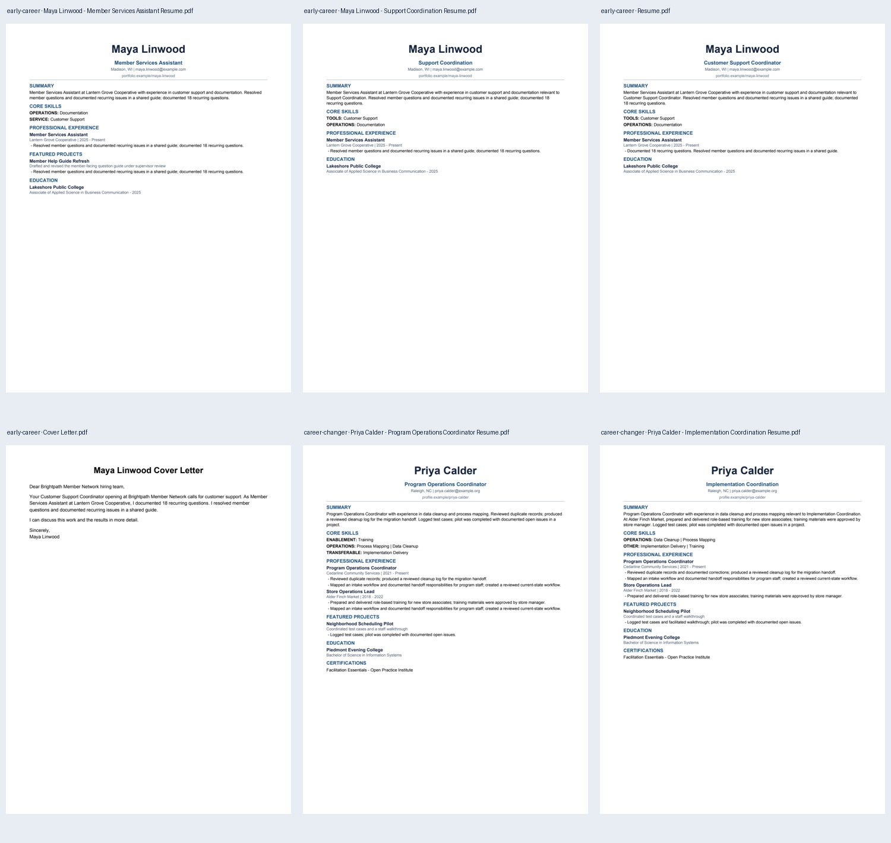
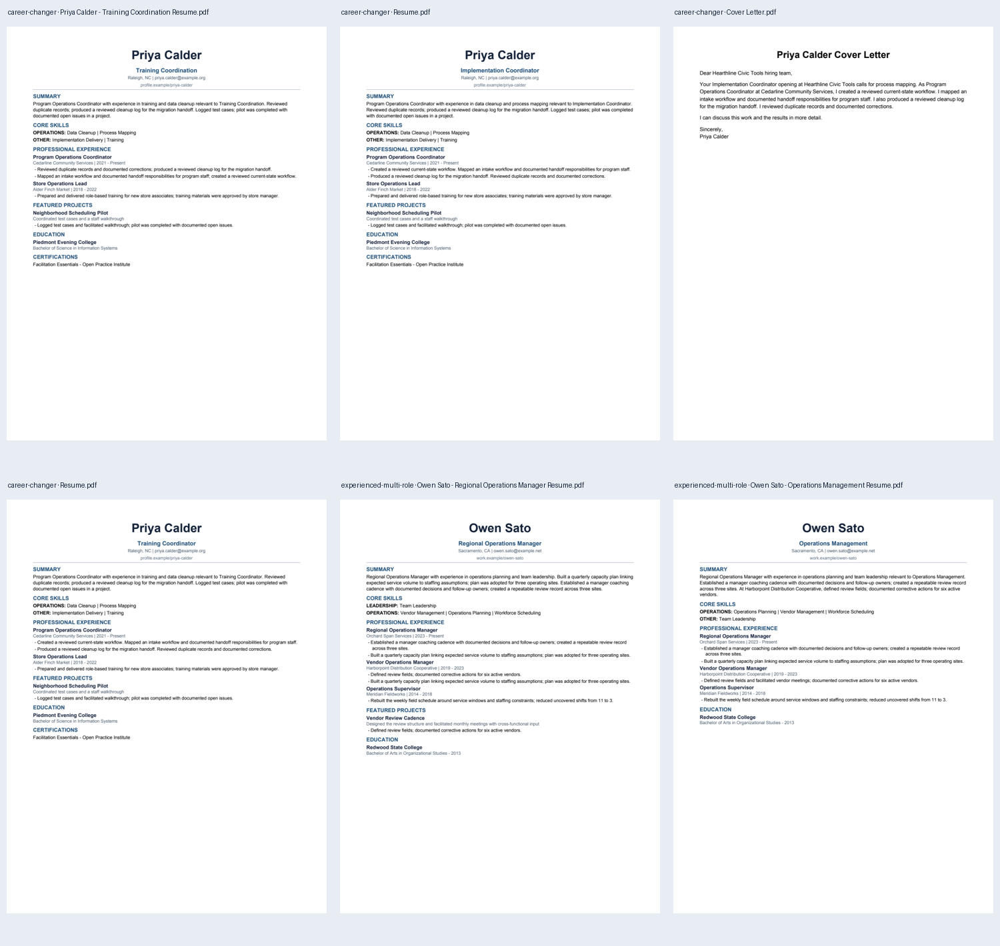
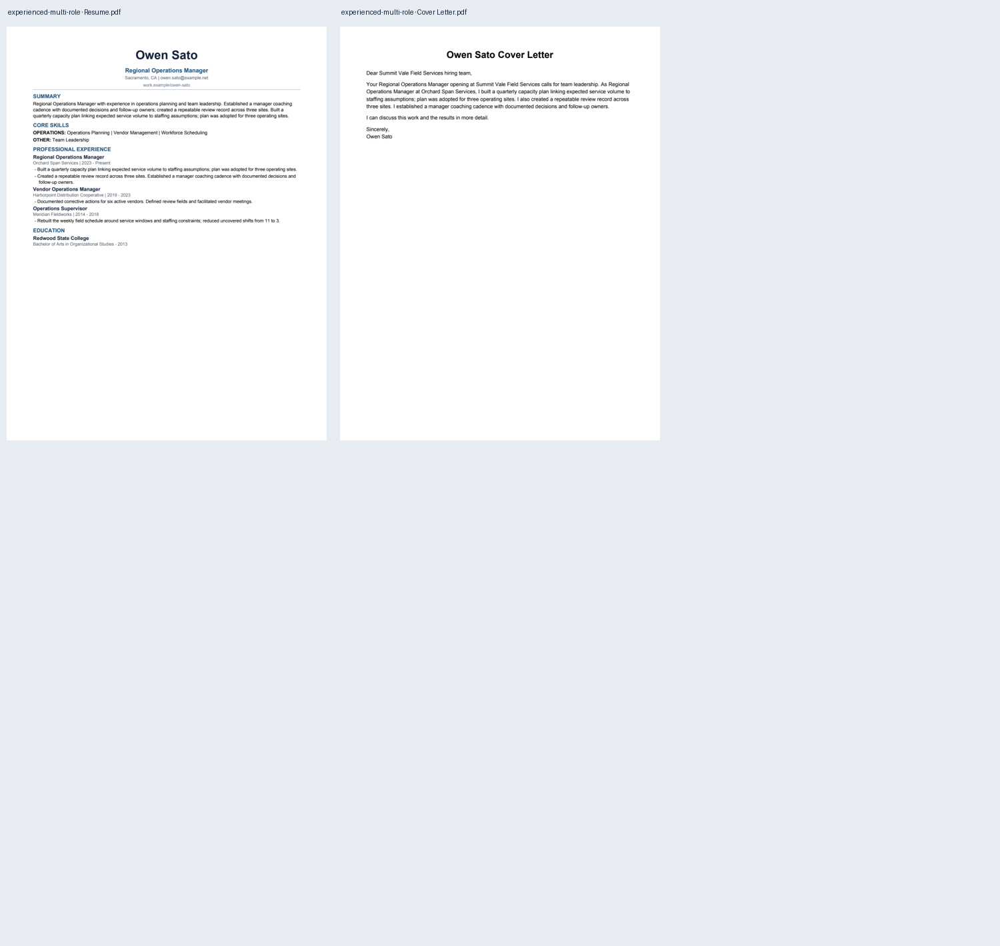
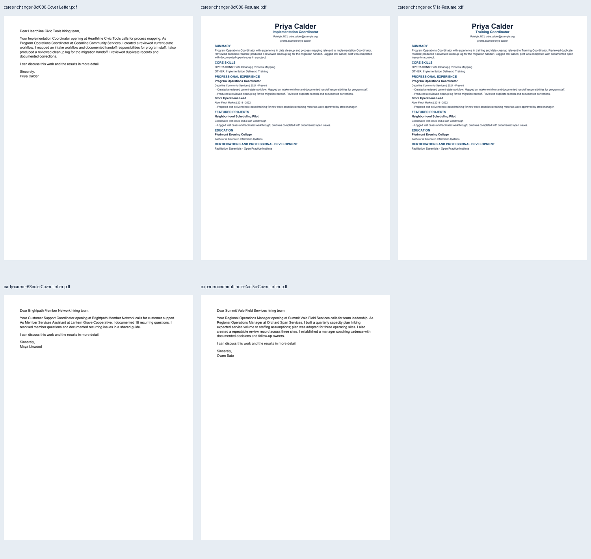

# From career history to a prepared application

[Career OS v0.4.3](https://github.com/dhwrd87/career-os/releases/tag/v0.4.3) completes the application handoff. It reuses the existing career, discovery, qualification, resume, editorial, learning and tracking engines. Earlier releases remain unchanged. Install v0.4.3 with the resume and DOCX extras using the [setup guide](installation.md).

Start with “Build my master resume and help me choose a career direction.” The assistant imports your history, shows what it found and asks about missing accomplishments or qualifications. You approve the facts before they are saved. The normal setup produces a master recruiter resume, evidence questions, role ideas and a practical job-search plan. Your complete approved history stays in the career record; resumes are presentations of that history.

Choose the directions that interest you. Career OS can prepare several distinct starting resumes, using each direction's headline, summary, supported accomplishments, skills, projects, education and credentials. Review a base before accepting it. Choosing another direction retains earlier directions and their documents.

Ask “Find jobs that fit my experience.” The assistant reads current employer postings, checks the full requirements and your preferences, and sorts them into Ready Now, Stretch Roles and user-chosen Dream Roles. Required qualifications, unfamiliar terms and incomplete information still need honest review. The workflow selects a relevant approved career family for each job, then uses Job Description Intelligence, employer needs, V2 recruiter copy and V1 editorial checks to tailor the supported content.

Ask “Prepare complete application packages for my five strongest matches.” The workflow prepares all feasible drafts and returns a Start Here page for each employer and exact title. A missing salary answer does not prevent the resume from being prepared. A qualification or document-validation failure remains visible and is not bypassed.

## Inside each package

- Start Here HTML and Markdown with application instructions, links and a practical checklist.
- The exact employer/title, posting link, separately verified application link when available, source and freshness information.
- The saved original job description and qualification/employer-needs assessments.
- A checked tailored resume PDF and editable DOCX from the same content.
- Cover letter PDF and DOCX when required, requested or useful for a supported transition or meaningful optional field.
- Actual captured questions, proposed answers and clearly unanswered questions. Anticipated practice questions are labeled separately.
- Internal validation results and a manifest with every document's hash. Upload only the requested recruiter-facing documents; assessments and validation files are private working material.

The folder is self-contained. Copying it elsewhere preserves its local document links. It remains a draft for review. The live form can add conditional questions or change after capture; check it before applying. DOCX content is checked, but layout should also be reviewed in your editor. No universal ATS or automated-screening success is claimed.

## Answers you can reuse

The answer bank is stored in your private workspace. Saving an answer requires your approval. It matches the exact question, selected employer/role scope and the current approved career source. Changed career information requires renewed review. Consequential personal declarations also require explicit employer, role and location scope. The assistant never guesses work permission, salary, availability, legal declarations or consent.

Professional drafts use evidence in the validated resume, preserving the actual employer, title and project context. You may approve personal preferences or motivation separately. Required unanswered questions are grouped for you; optional demographic questions remain optional. Draft answers are not submitted automatically.

## Source and application links

A general job page is not assumed to be its application form. A direct link needs its observed source, capture time and explicit verification. Without that evidence, Start Here says the direct link is not verified.

The Greenhouse reader can capture a specific job's actual form questions using its public read-only endpoint. This follows the [official Job Board API](https://docs.greenhouse.io/job-board.html). Custom employer sites may require the assistant to follow an observed Apply link. Other providers use reviewed catalogs and captured question sources. Authentication walls and later conditional questions remain visible limits.

## Assistant tools

These commands are for the assistant; users can ask in ordinary language.

```sh
careeros --workspace <workspace> workflow strategy
careeros --workspace <workspace> workflow directions --intent-index 0 --intent-index 1 --approve --actor <owner>
careeros --workspace <workspace> workflow prepare --top 5
careeros --workspace <workspace> application prepare --opportunity-id <id> --build-id <id> --cover-letter REQUESTED
careeros --workspace <workspace> application answer-bank --input <reviewed-answers.json> --approve --actor <owner>
careeros --workspace <workspace> discover-source --greenhouse-board <verified-board> --job-id <actual-id> --employer <verified-employer> --approve-network
```

Use `workflow prepare --resume-only` for a resume-only request. AUTO cover letters follow the recorded requirement and useful supported context. OMIT does not suppress a required letter. Directions must already exist in the approved career preferences; use the existing review/update workflow to add a new goal. Base acceptance remains a separate review action.

After applying yourself, report the activity so Career OS can track the correct resume and posting. Interview preparation and outcome reporting reuse those records. Stretch and dream-role plans keep courses, certifications, projects, practical experience and evidence gaps separate. Better-paying-role requests need a pay baseline, currency and period plus observed posting pay; a title is not proof of higher pay.

Reproduce the fictional journey with `python scripts/build_application_example.py --output /tmp/career-journey-example`. No applications, messages or commitments are made. [Open the saved example](../examples/application-journey/README.md).


## What was executed for this release

Three fictional profiles produced three master resumes, four career-specific bases, four tailored application folders, three required letters, interview materials and separate stretch/dream plans. The career changer has two distinct directions and two different job-specific packages. The existing eight-person onboarding matrix also passed. The independent agent run completed the local journey and its copy recheck; that is not independent human evaluation.

| Journey step | Executed evidence |
|---|---|
| Import history and find missing detail | Approved setup, retained career record and evidence-review output; source-first persona matrix |
| Master recruiter resume | Default setup output, PDF and factual/editorial/ATS checks |
| Strategy, families and titles | Generated search plan, recorded goals and grounded role suggestions |
| Family-specific bases | Two distinct career-changer bases; explicit acceptance and reuse tested |
| Current jobs and full descriptions | Live Greenhouse board/detail capture; reviewed Stripe Administrative Coordinator posting |
| Qualification and prioritization | Full required/preferred needs checked; unqualified live example held rather than forced through |
| Job-specific adaptation and QA | Existing Job Description Intelligence, employer needs, V2/V1, factual, coverage, ATS/import-field and visual gates retained |
| Complete application packages | Self-contained Start Here, 17 hashed files in the required-letter example, PDF/DOCX exports, saved original description and assessments |
| Screening and answer reuse | Actual captured questions versus anticipated practice; scoped approved bank; missing declarations visible |
| Batch preparation | Four packages across three profiles, including two distinct jobs for one candidate |
| Tracking, interviews and outcomes | Real local event/projection machinery with explicitly fictional reported activity; no external action |
| Stretch and dream development | Six target-specific plans; missing verified course facts remain visible rather than invented |

Actual live verification on 24 November 2026 retrieved 18 application questions and followed the employer's observed [Apply link](https://stripe.com/careers/apply/administrative-coordinator/8223719) to its form. This is a dated verification, not a promise that the opening will remain available. Its Mexico City requirements did not establish qualification for the fictional comparison profile, so no application was prepared for it. The public example uses original fictional text and does not misrepresent a live vacancy.

Fourteen generated PDF pages and five independently rendered DOCX exports were visually inspected. The Start Here desktop page had no horizontal overflow or console errors. Sparse letters remain a disclosed consequence of thin source evidence; no padding or hiring claims were added.

Saved answer changes produce a new immutable document packet linked to the same tracked application through the existing event log. Previous packets remain unchanged. Submitted or closed applications are held out of automatic preparation; an exact historical packet remains retrievable. A changed job description requires new qualification and a matching resume. Tampered documents or manifests fail verification.








