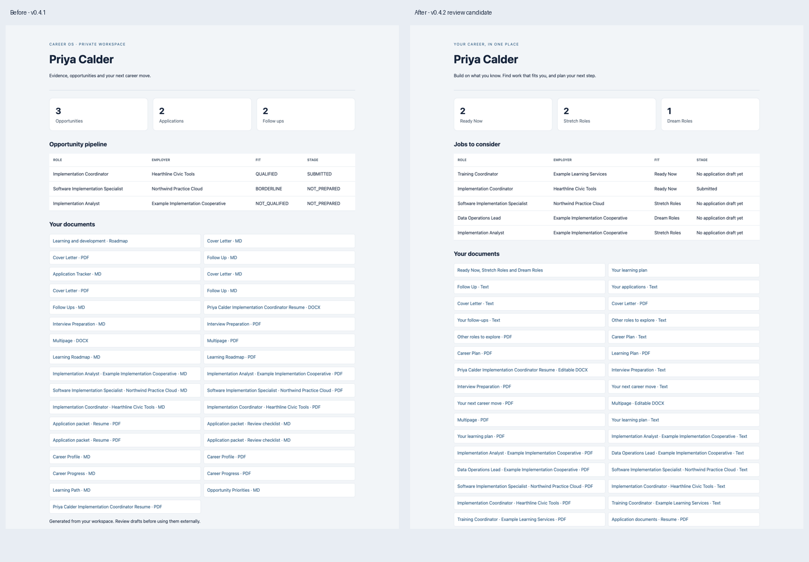
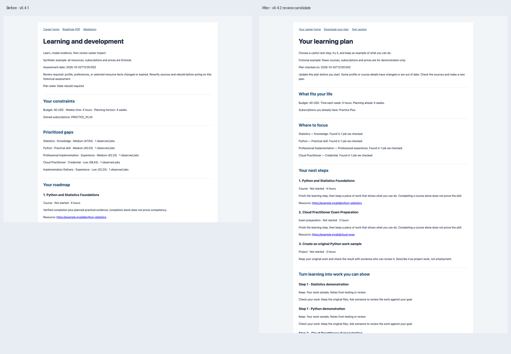
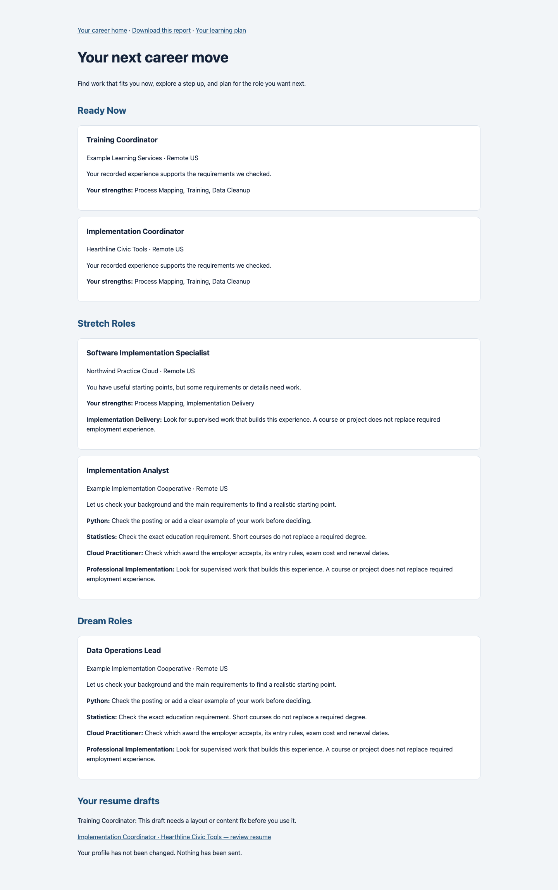

# A clearer way to find work and plan your career

The v0.4.2 review candidate addresses [issue #1](https://github.com/dhwrd87/career-os/issues/1). It connects the existing tools and replaces internal labels with clear advice. The published v0.4.1 release stays unchanged.

| Before | After |
|---|---|
| Separate discovery, comparison, resume and learning commands | One search flow compares reviewed postings and prepares suitable resume drafts. |
| Technical fit labels such as `QUALIFIED` | Ready Now, Stretch Roles and user-chosen Dream Roles, with plain reasons and questions. |
| Career ideas based mainly on stated goals and skill groups | Ideas from actual work history and relevant requirements in checked postings. |
| General learning gaps across several roles | A separate career plan and learning PDF for the chosen target role. |
| Internal terms in questions, reports and assistant guidance | Direct questions, readable reports and ordinary requests such as “Find jobs that fit me.” |

The left images are the published v0.4.1 synthetic outputs. The right images come from this candidate's generated workspace. The views show the top of each page; they are not design mockups. The same blue and gray design, resume template and rendering checks remain in use.

## Try the complete example

Open the [fictional workspace](../examples/workspace/README.md), [job results](../examples/workspace/outputs/job-search/your-next-move.md), [other role ideas](../examples/workspace/outputs/career/other-roles.md) and [learning plan](../examples/workspace/outputs/learning/learning-roadmap.md). The search prepares two separate tailored resumes and groups jobs by what the person can do now and what needs work. Data Operations Lead is a goal the example user chose.

The examples use fictional jobs and course offers. Their dates are fixed for repeatable demonstrations. The dashboard warns when saved training details are out of date. Do not use the example prices or treat the fictional roles as vacancies.

## What was checked

The new executable journey tests cover search, role ideas, batch resume preparation and target plans. They also cover same-title jobs, repeat runs, stale sources, unknown requirements, location filters, blocked qualifications, source failures and the actual CLI routes used by the skill. The existing test suite, migration checks and eight-persona installed-wheel matrix remain part of candidate validation.

Four actual resume PDFs across three backgrounds passed their document checks. PDFs and reports were rendered for review, and editable resumes were independently rendered with LibreOffice. Desktop and mobile pages had no page errors or horizontal overflow. Existing visual goldens were retained.

The live read-only check used a synthetic profile and generic title filters against [Stripe's public careers source](https://stripe.com/careers/search). On 24 November 2026 it returned 85 selected postings from 771 source records. One full posting was reviewed, its eleven requirements were retained, and a target plan was generated. The example profile did not qualify, so no resume was forced through. No private career fields or external writes were involved. This demonstrates bounded discovery, not coverage of every job board.

An independent skill run completed the connected request and checked the actual output files. Its findings led to fixes for source-description consistency in the fictional example, target-specific reassessment, and an overstated transferable-skill explanation. Unknown details still require review. Completing training does not change approved career facts or count as professional experience.

A simple readability estimate placed the README near grade 8 and the main user guides around grades 8–9. This was a writing aid, not a claim that every technical name or source quotation has that reading level. Developer contracts retain their exact terms.

## Review and limits

This is a pull-request candidate, not a new published release. CI provides a downloadable candidate wheel, source archive, skill archive and release manifest. Install the matching package and skill to try it. See [installation](installation.md), [release notes](release-notes-0.4.2.md) and [upgrade guidance](versioning-and-migrations.md).

Public employer searches still need accessible sources and review of the full requirements. Location and work-mode filters help narrow results; pay, schedule and other personal constraints may need the assistant's source review. Course details must be current. No applications, messages, purchases or enrolments are sent automatically. Existing environment, font and document-format limits remain in the README.
