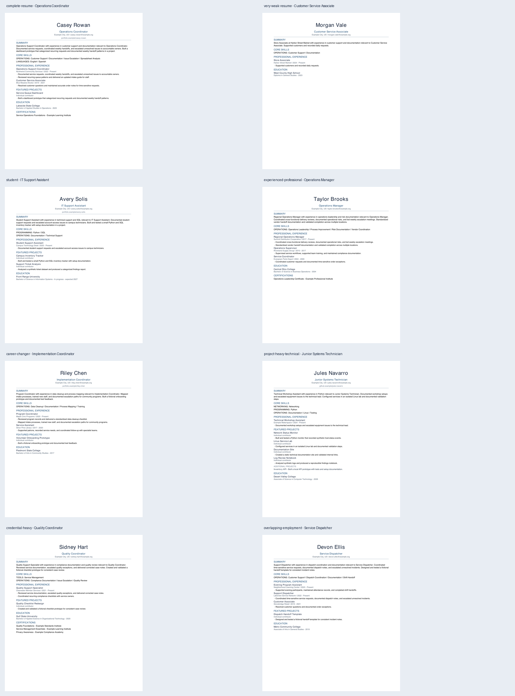
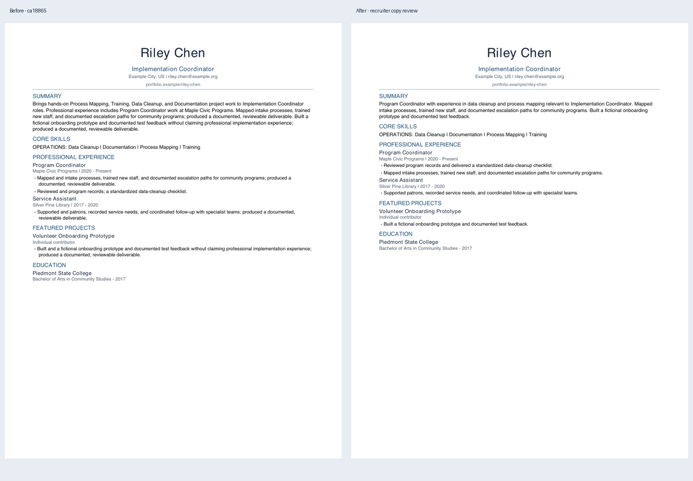
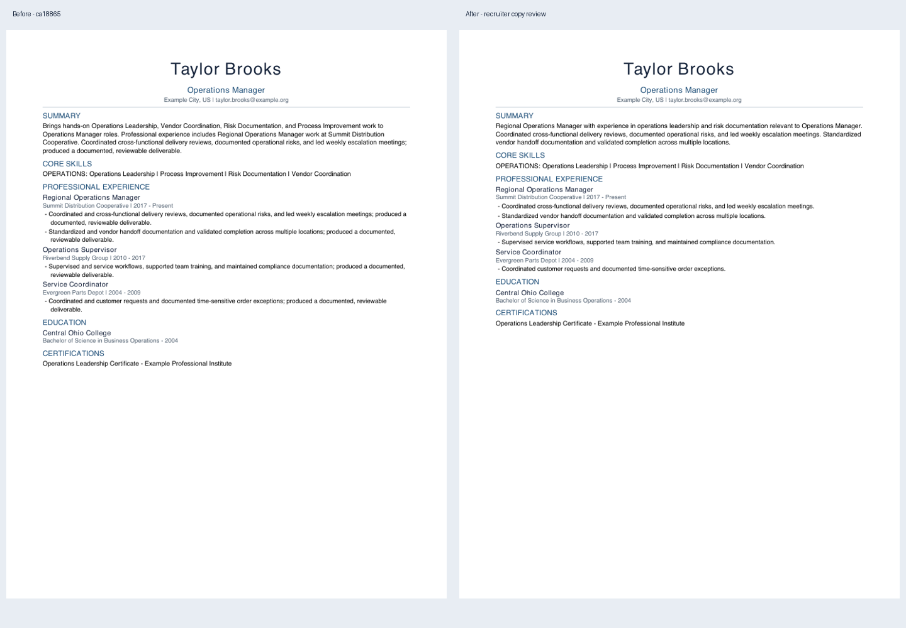

# Recruiter copy review — v0.4.2

This focused update improves the actual master, career-specific and tailored resumes, summaries and cover letters in [PR #2](https://github.com/dhwrd87/career-os/pull/2). It builds on Recruiter Conversion Copy Engine V2 and Resume Editorial Intelligence V1. The recovered writing standard remains the guide: concrete work, a clear career story, defensible results, plain language and no invented achievements.

The findings below are an internal editorial assessment supported by executed outputs. They are not independent recruiter feedback, a hiring study or proof that Career OS outperforms another product.

## See the actual outputs

[Open the eight-person example set](../examples/recruiter-copy-review/README.md) for all 32 current PDFs: a master resume, career-specific resume, tailored resume and cover letter for each person. The same set includes editable resumes, extracted text and the exact fictional postings. Each comparison uses the same approved career profile and job description. Approved career facts were not changed to improve the writing.

The left column is the actual earlier PR output from commit `ca18865`. The right is the updated output. The design, font sizes and page margins are preserved. These are rendered documents, not template previews.

## What changed in the writer

- A parsed verb such as “Mapped” now recovers the complete statement from its own career record. It cannot borrow a responsibility from the job description.
- Summaries establish an actual professional identity and select two relevant proof points. A master resume no longer inserts its internal document heading into the summary. Skill lists no longer substitute for work examples.
- Short, completed results can lead tailored bullets. Activity, output and business impact stay distinct; a deliverable does not become a claim of revenue, efficiency or customer benefit without a source.
- Generic filler such as “produced a documented, reviewable deliverable” is omitted from public copy. Original records retain their detail and references.
- Project and lab context stays clear. Drafting cautions and verification notes stay internal, including project sublines that previously escaped the copy check.
- Cover letters connect the posting to selected examples in natural paragraphs. They avoid a resume inventory, repeated role introductions, invented company praise and stock enthusiasm.
- Useful fifth and sixth projects can use the existing compact presentation. This repaired a demonstrated loss of testing evidence in the project-heavy persona.
- Career-specific rebuilds include the writing content in their identity and preserve accepted PDFs. A new draft does not replace the accepted career-specific resume until it is accepted.

The existing checks also exposed two rules that rewarded filler: minimum summary length and a concision penalty for short text. A short summary of 15–24 words is now allowed only with traced source support and no filler; normal summaries keep the 25–80-word range. This follows the recovered standard's preference for a shorter factual summary over padding. Numeric quality thresholds were retained. This is an explicit behavior change, not a claim that short writing is always better.

## Writing comparisons

| Earlier output | Updated approach | Why it helps |
|---|---|---|
| “Mapped; produced a documented, reviewable deliverable.” | Restore the person's full statement about intake processes, staff training and escalation paths. | The reader can see what the person actually did. |
| A four-skill opening followed by an internal master heading | Actual professional identity followed by selected work examples | Establishes a credible career story without a tool inventory. |
| A generic reviewable deliverable repeated across unrelated jobs | The specific guide, checklist, prototype, handoff or documented result in the source | Shows useful output without inventing commercial impact. |
| A project warning such as “did not configure the production system” | A positive description of the actual project contribution, with project context retained | Explains the work without suggesting professional deployment or printing internal cautions. |
| Repeated “As a … my work included” paragraphs | One role-specific opening and related factual examples in connected prose | Reads more like a short personal letter. |

## Internal assessment

| Criterion | Finding from the actual outputs |
|---|---|
| Recruiter readability | Complete actions and clear identities replace orphaned verbs and internal headings. Thin profiles remain brief. |
| Persuasiveness | Specific outputs are more useful than generic deliverable claims. Several fixtures lack measurable business impact; the writer does not manufacture it. |
| Role relevance | Posting requirements guide evidence selection and order. The current tests exercise every persona through a job-specific resume. |
| Credibility | Actual titles, project context, permitted metrics and source references remain protected. Courses do not become employment. |
| Differentiation | The person's work and strongest examples now carry the story. Repeated facts can still produce similar language; review remains useful. |
| ATS compatibility | The existing selectable-text, extraction, reading-order, field and document checks apply to the generated files. No universal ATS-vendor guarantee is made. |
| Layout | The existing single-column design is retained; additional projects use its compact layout. Actual pages and editable exports are reviewed. |
| Overall preference | The internal review favors the updated copy over this PR's earlier outputs because it fixes specific observed defects. There is no independent human preference result. |

The earlier targeted project-heavy resume was held by its completeness check. It is not counted as an earlier passing application. The updated version preserves the missing supported skill and passes the existing checks.

## Competitor comparison: exact limits

The named products were considered as market references. Marketing examples are not matched candidate outputs and are not used as a substitute for a comparison.

| Product | What was accessible | Matched candidate result |
|---|---|---|
| [Kickresume](https://www.kickresume.com/en/ai-resume-summary-generator/) | Public summary tool; a fictional PDF upload was attempted. The Chrome extension's local file-access setting blocked it. | No generated summary obtained. |
| [Enhancv](https://enhancv.com/) | The anonymous builder reached its position step. The browser became unavailable before a complete candidate could be entered. | No generated resume obtained. |
| [Teal](https://www.tealhq.com/tool/resume-summary-generator) | The public summary page directs generation to account signup; its page states a free account includes limited generations. | No account was created and no candidate output obtained. |
| [Resume Worded](https://resumeworded.com/) | Public upload route reached. The later file-chooser session expired without returning a score or rewrite. | No score or generated output obtained. |

No paid plan, new account or browser security change was made. No independent human evaluator participated. The example set makes review possible, but it is not a completed blind human evaluation. Competitive preference, professional-writer equivalence and superior hiring outcomes remain unverified.

## Reproduce and review

Use the existing synthetic onboarding matrix, then `scripts/review_recruiter_copy.py` with the saved fictional postings. The script uses the real master, career-specific, tailoring, cover-letter and DOCX tools and asserts that career facts remain unchanged. It does not contact an employer or submit an application.

`examples/recruiter-copy-review/results.json` records the document results and page counts. Its copy scores are internal heuristics. Historical fields called `human_test` are automated checks, not human feedback. Review the rendered files and facts as well as the test results.

The final installed test results, CI and checksums are attached to the candidate receipt and PR. Existing visual goldens are retained. The candidate remains for owner review; this update does not merge the PR or publish v0.4.2.

## Remaining limits

Input quality still sets the ceiling. The weakest persona has one short work example; it cannot honestly support the accomplishments of a detailed senior resume. Some letters are much shorter than the recovered 220–325-word target because the fixtures supply only one or two useful facts. They are concise drafts for review, not proof of expert personalization. Add real examples, results and motivation before expecting a richer letter.

The deterministic writer can still benefit from human editing, especially for nuanced career transitions, distinctive motivation and complex business impact. No external hiring outcome or independent preference study was run. Existing Windows, Microsoft Word, script/font, document accessibility and ATS-vendor limits remain disclosed in the README.
