# Visual comparison gallery

[Career OS v0.4.2 is available](https://github.com/dhwrd87/career-os/releases/tag/v0.4.2). For the wording and workflow changes, see the [current before-and-after examples](human-experience-update.md). The historical comparisons below remain available; newer workspace, learning and editable-resume screenshots are refreshed from the current synthetic example.

Every image here is a saved render or screenshot of actual generated synthetic artifacts. Reference columns use the actual personal standard and compact renderers with fictional input; the right column uses the public renderer. No private career data, private accepted PDF or private golden is included. Wider margins and single-column flow are deliberate public defaults.

## Early career

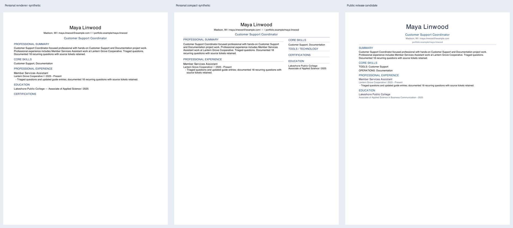

## Career changer

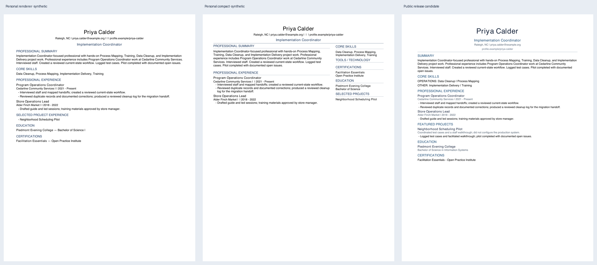

## Experienced professional

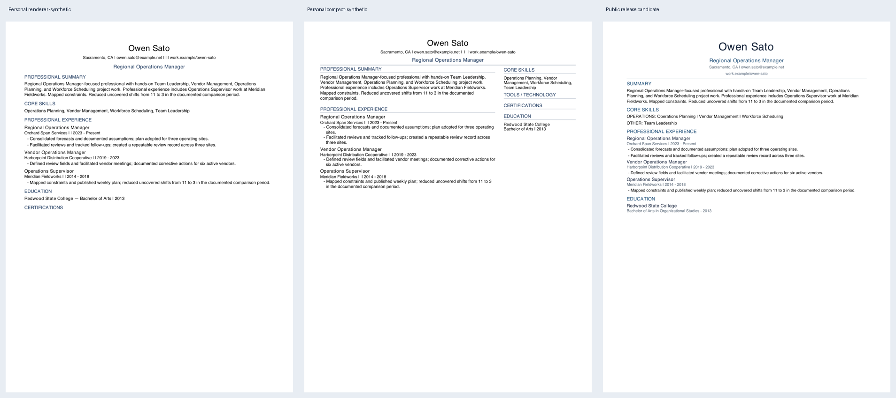

## Editable output

The left is the validated PDF. The right is a LibreOffice rendering of the actual exported DOCX, built from the same semantic content. Arial substitution, spacing and pagination can differ; the DOCX is editable and is not the canonical accepted PDF.

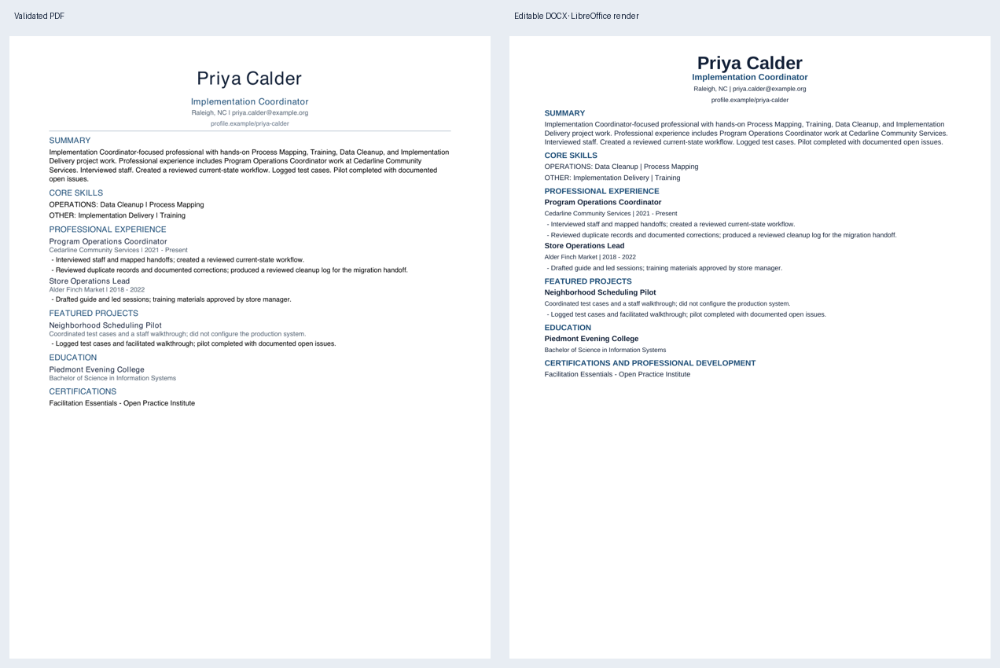

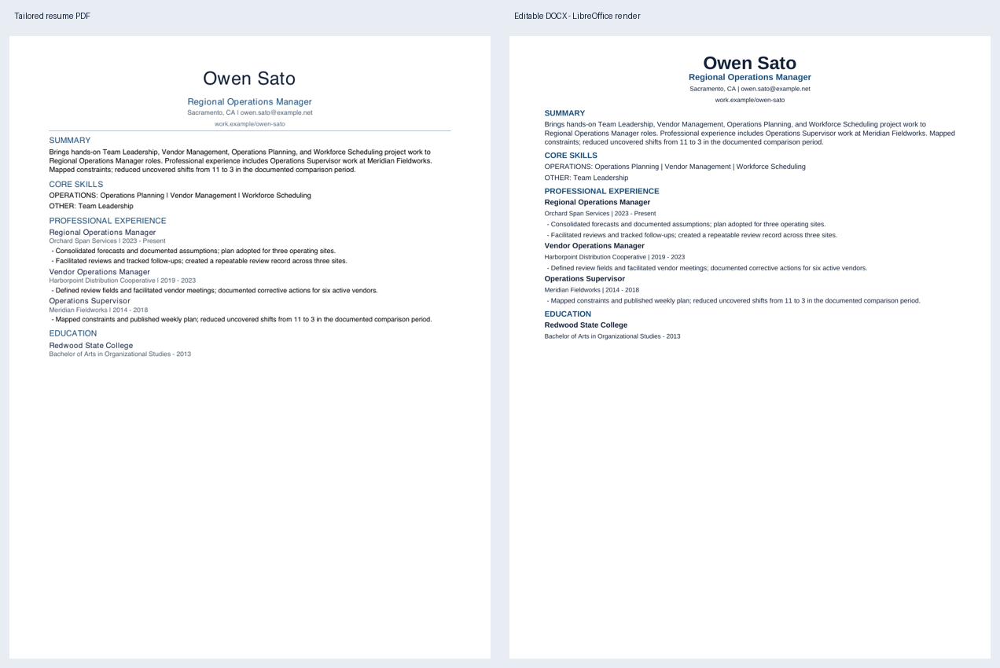

## Two-page layout handling

The stress fixture expands wholly synthetic roles and bullets to exercise page composition. It is a renderer test, not an accepted application or a fabricated candidate history.

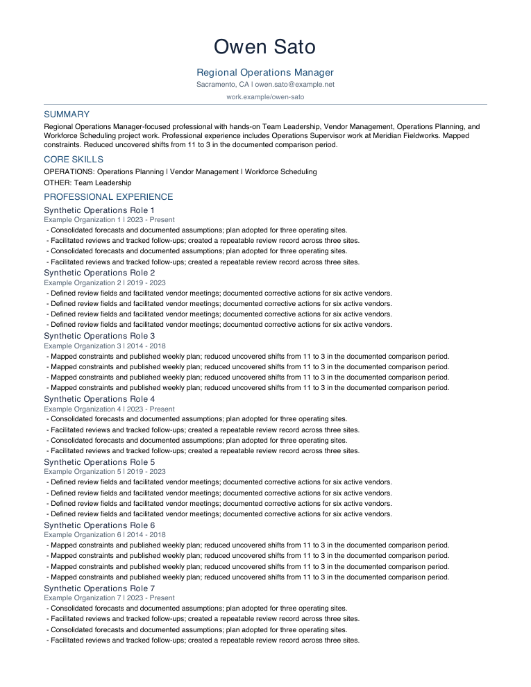

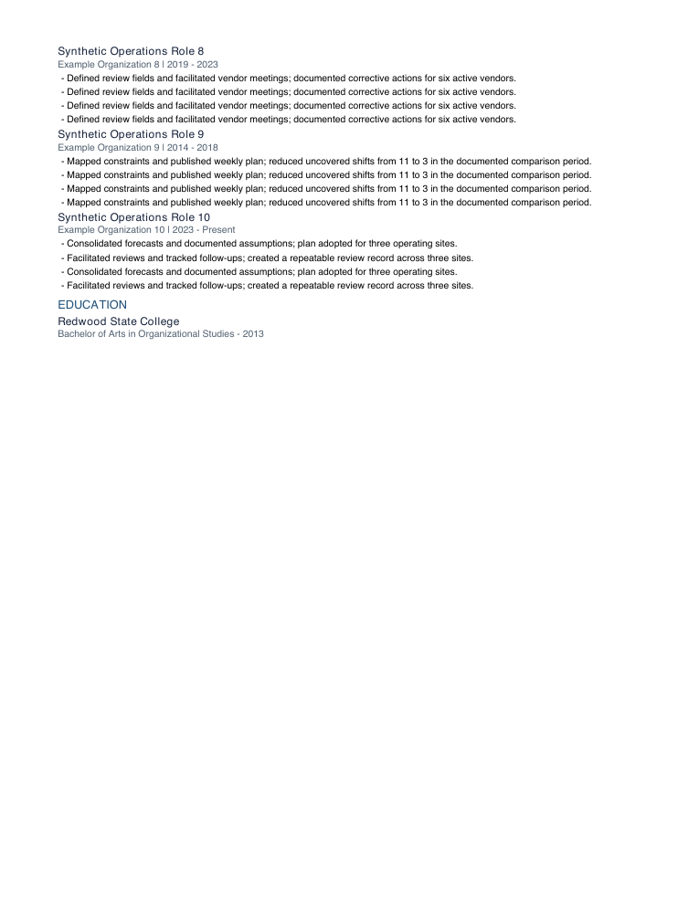

## Workspace navigation

The screenshots show the actual local dashboard at desktop and mobile widths. Browser checks found no page errors or page-level horizontal overflow. Each document link identifies its format; opportunity reports identify role and employer.

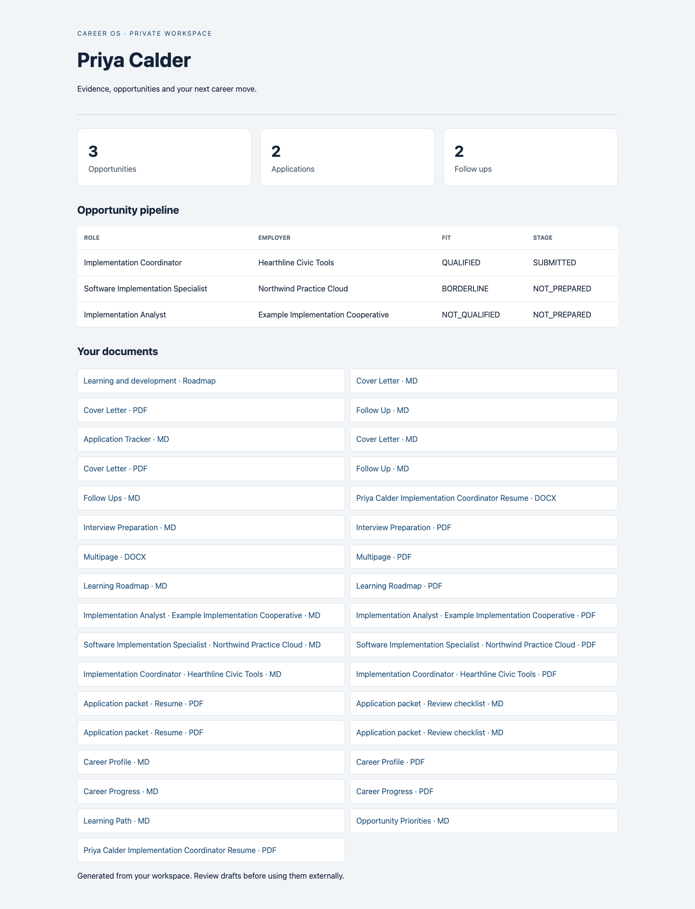

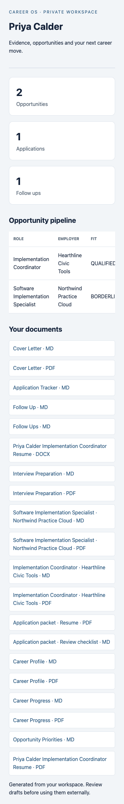

## Generated reports

All pages of the synthetic career-changer profile, progress, opportunity, cover-letter and interview PDFs were rasterized for review. These are private-workspace reports, distinct from recruiter-facing resumes and letters.

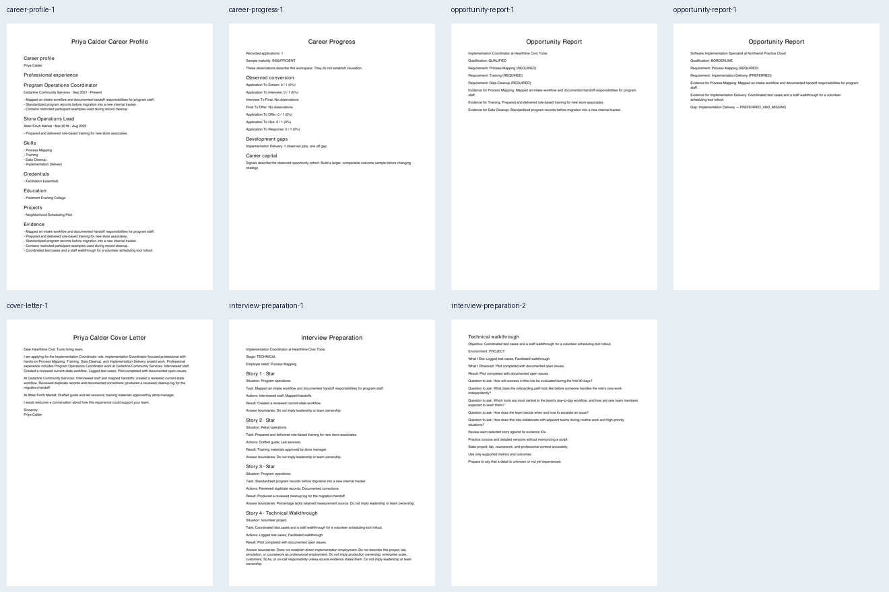

The [example workspace](../examples/workspace/README.md) includes the actual PDF, DOCX, Markdown, data and lineage behind the demonstration. The release includes these reviewed synthetic examples. Existing private and synthetic visual goldens remain unchanged.

The multipage DOCX was also rendered independently; both pages were inspected:

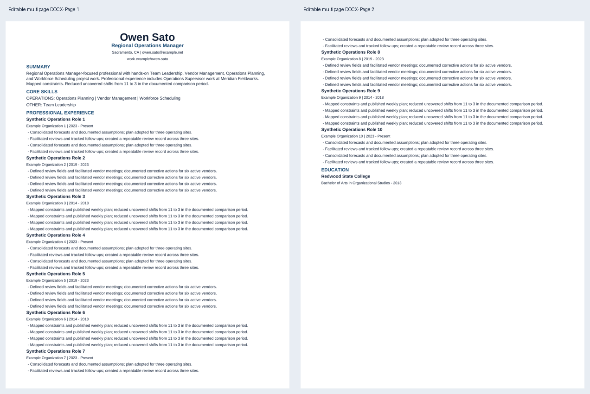

## Final installed-wheel persona matrix

These eight lane-base outputs came from the exact release wheel in an isolated installation with freshly resolved declared dependencies. Every persona passed its executable checks.

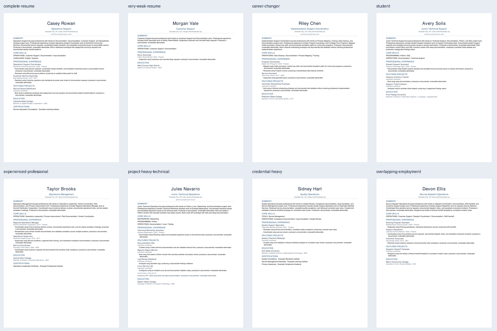

## Learning Path Intelligence

The left column below is the actual 0.4.0 generated learning Markdown rendered as a PDF for comparison. The right is the new actual 0.4.1 roadmap PDF using the same fictional job/resource inputs. The prior output had no evidence plans; the new module keeps typed gaps, user constraints, practical evidence, honest exclusions and career reassessment visible. This compares executed outputs, not source templates. Reference methodology remains the recovered V1 learning/evidence integration flow; no private course portal or candidate data is included.

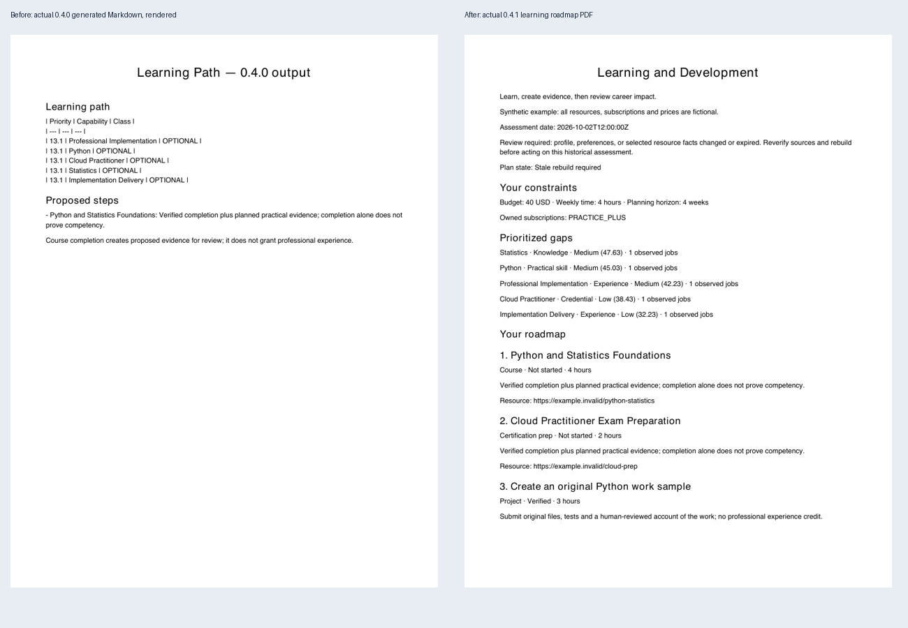

All 4 pages of the generated learning PDF were rendered and visually inspected. Logical entries stay together; text is selectable. Recommendations are synthetic, not current provider offers.

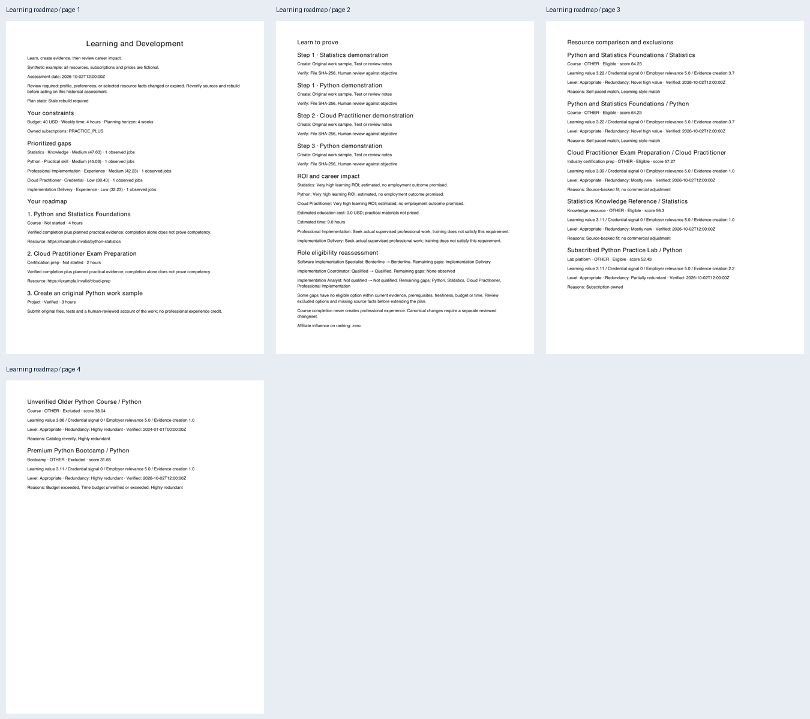

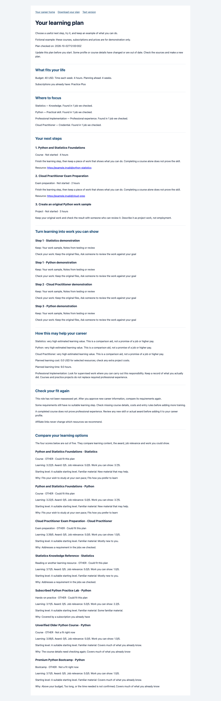

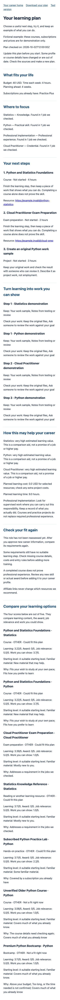

## Recruiter-copy review

See the [eight-person copy gallery and assessment](recruiter-copy-review-0.4.2.md). It includes actual master, career-specific, tailored and cover-letter outputs, with the limits of competitor and human evaluation clearly stated.
